ESCL -- Engineering Sports Club

Overview

ESCL (Engineering Sports Club) is a full-stack cricket league management
web application designed for engineering college cricket tournaments.

The application provides a modern public-facing website for players and
visitors along with a dedicated administrative dashboard for managing
league operations.

The project focuses on presenting cricket league information, player
registrations, schedules, upcoming series, points tables, and contact
enquiries through a clean and responsive user interface.

Key Features

Public Website

Professional ESCL landing page

Season highlights and league statistics

Player registration

User login

Match schedule

Upcoming series information

Points table

Contact / enquiry form

Responsive and user-friendly interface

Player Registration

Players can register by providing details such as:

Full Name

College / University

Branch

Year of Study

Date of Birth

Preferred Playing Position

Experience

CricHeroes URL

Base Price

Email

Password

Payment Method

The registration data is handled by the backend and stored in the
database.

Admin Dashboard

The project includes a dedicated ESCL Admin dashboard for league
management.

Dashboard

The dashboard provides an overview of:

Registered Players

Scheduled Matches

Upcoming Series

Contact Messages

It also provides sections for league analytics and points-table
movement.

Manage Players

Administrators can:

View registered players

Search players by name or email

Add players

Edit player information

Remove player records

Manage Schedule

Administrators can manage:

Series

Matches

Venue

City

Match date

Match status

Supported operations include creating, editing and removing match
fixtures.

Manage Series

Administrators can:

View upcoming series

Add a series

Edit a series

Remove a series

Manage Points Table

Administrators can manage team standings including:

Season

Position

Team

Matches Played

Wins

Losses

Ties

No Results

Net Run Rate

Points

Manage Messages

Administrators can:

View contact enquiries

Open message details

Review sender information

Delete messages

Technology Stack

Frontend

React.js

Vite

JavaScript / JSX

HTML5

CSS3

REST API integration

Backend

Java

Spring Boot

Spring Data JPA

REST APIs

Database

MySQL

Authentication

Session-based authentication

The application uses server-side session-based authentication rather
than JWT-based authentication.

Development Tools

Visual Studio Code

Eclipse / Spring Tooling

Git

GitHub

Postman

Project Structure

Frontend

public/
src/
├── assets/
├── components/
├── context/
├── hooks/
├── layouts/
├── pages/
├── router/
├── services/
├── styles/
├── utils/
├── App.jsx
└── main.jsx

.env.example
.gitignore
README.md
index.html
package.json
package-lock.json
vercel.json
vite.config.js

The frontend structure separates reusable components, application
context, hooks, layouts, pages, routing, API services, styles and
utility functions to keep the application maintainable.

Application Flow

Visitor
   │
   ├── Home
   ├── Schedule
   ├── Upcoming Series
   ├── Points Table
   ├── Contact
   │
   ├── Register
   │      │
   │      └── Player Registration
   │
   └── Login
          │
          └── Authenticated User
                  │
                  └── Admin Dashboard
                         ├── Manage Players
                         ├── Manage Schedule
                         ├── Manage Series
                         ├── Manage Points Table
                         └── Manage Messages

Backend API Architecture

The application follows a standard layered backend architecture:

React Frontend
      │
      │ HTTP / REST API
      ▼
Spring Boot Controllers
      │
      ▼
Service Layer
      │
      ▼
Repository Layer
      │
      ▼
MySQL Database

This separation keeps presentation, business logic, data access and
persistence responsibilities organized.

Authentication

ESCL currently uses session-based authentication.

The general authentication flow is:

Login Form
    │
    ▼
Spring Boot Authentication
    │
    ├── Validate Credentials
    │
    └── Create Session
            │
            ▼
      Authenticated User

The application supports role-based access for the administrative area.

Database

MySQL is used as the primary relational database.

The backend uses Spring Data JPA for database interaction, allowing
application entities and repository operations to work with persistent
MySQL data.

Environment Configuration

Environment-specific configuration should be maintained using
environment variables.

Create a local .env file based on:

.env.example

Do not commit sensitive credentials or environment-specific secrets to
Git.

The repository already ignores .env through .gitignore.

Running the Frontend

Install dependencies:

npm install

Start the development server:

npm run dev

Create a production build:

npm run build

Preview the production build:

npm run preview

Backend

Start the Spring Boot backend from the backend project using the
configured Spring Boot application.

Make sure the MySQL database and required backend configuration are
available before starting the application.

API Testing

Backend REST APIs can be tested using Postman.

Typical operations include:

GET     Retrieve records
POST    Create records
PUT     Update records
DELETE  Remove records

The APIs are used for player management, schedules, series, points-table
data and contact messages.

Deployment

The frontend is configured for deployment using Vercel.

The project includes:

vercel.json

The backend can be deployed separately on a suitable Java/Spring Boot
hosting platform with the MySQL database configured for the deployed
environment.

Security Considerations

Authentication is session-based.

Database credentials should be stored in environment configuration.

.env files must not be committed to version control.

Administrative operations are intended for authenticated
administrative users.

Production deployments should use HTTPS.

Passwords should be handled securely by the backend.

Project Highlights

ESCL demonstrates practical implementation of a real-world sports
management platform with:

Modern React frontend

Spring Boot REST backend

MySQL database integration

Session-based authentication

Administrative dashboard

CRUD-based management modules

Player registration workflow

Match and tournament management

Points-table management

Contact enquiry management

Responsive and professional UI

REST API based frontend-backend communication

Future Scalability

The current architecture provides a foundation that can be extended with
additional features such as:

Live match scoring

Player statistics

Team management

Tournament analytics

Notifications

Payment integration

Email notifications

Advanced reporting

Mobile application support

These features can be introduced independently as the ESCL platform
evolves.

Conclusion

ESCL is designed as a practical cricket league management platform for
engineering sports communities.

It combines a public sports website with an administrative management
system, providing a complete digital workflow for player registration,
match scheduling, series management, points-table maintenance and
contact enquiry handling.

The project demonstrates full-stack application development using React,
Spring Boot, REST APIs, session-based authentication and MySQL.

## Screenshots

### Home Page
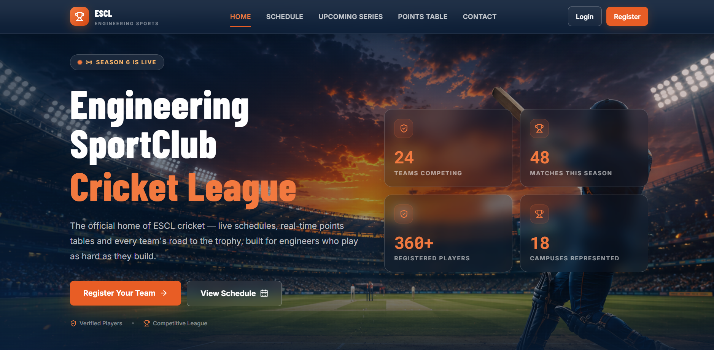

### Login Page
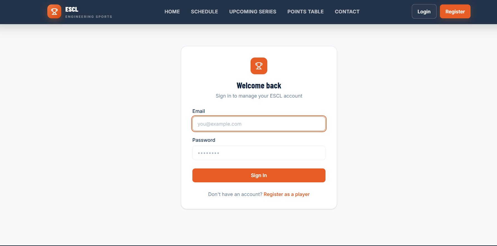

### Player Registration
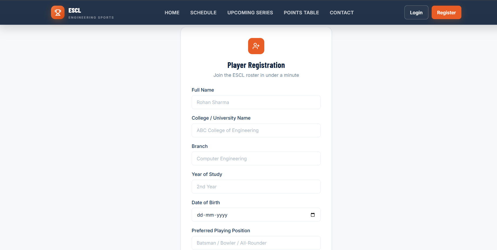

### Player Management
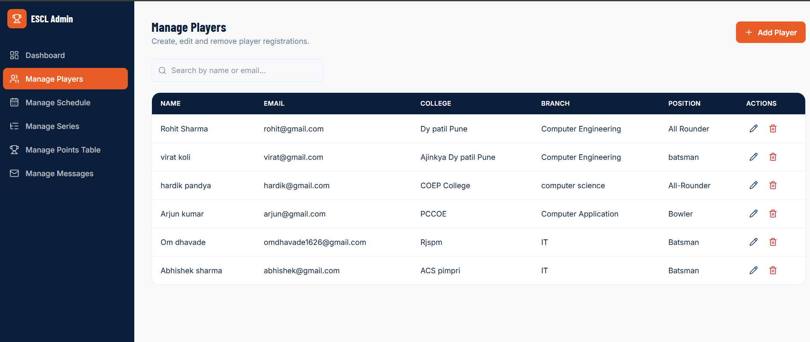

### Schedule
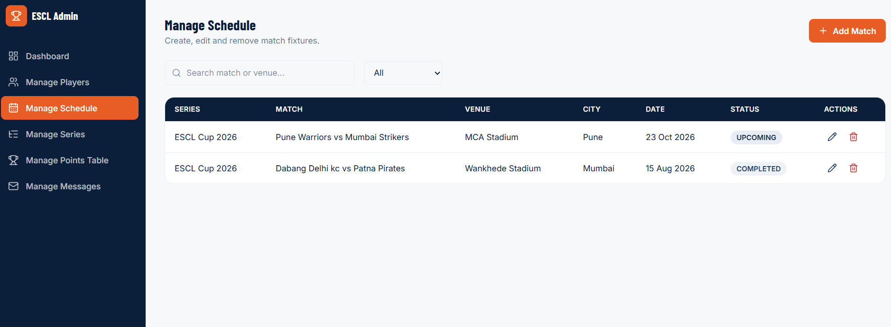

### Schedule Details
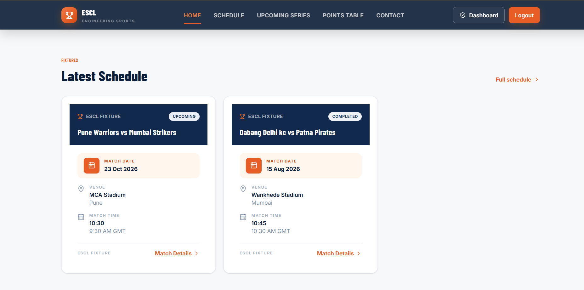

### Series
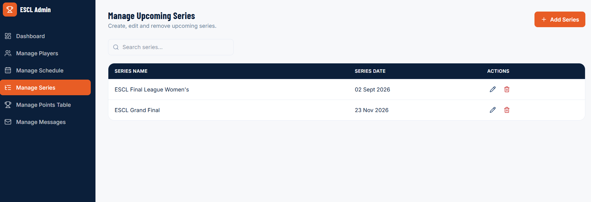

### Series Details
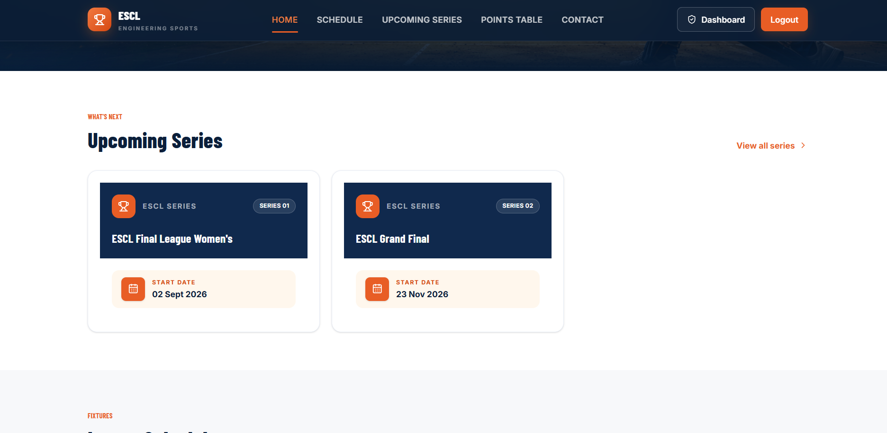

### Points Table
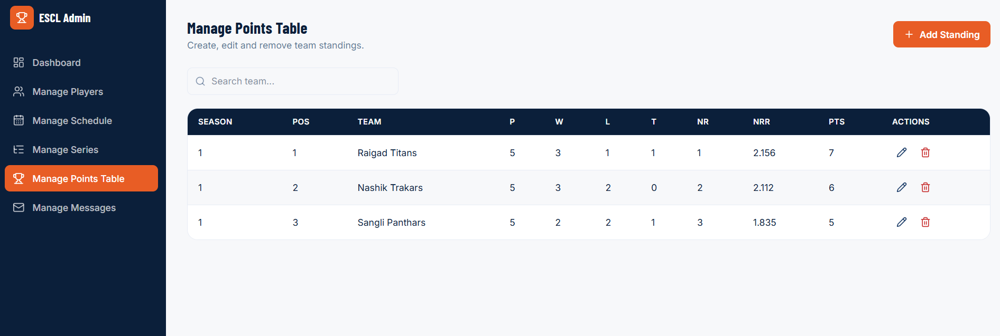

### Contact Page
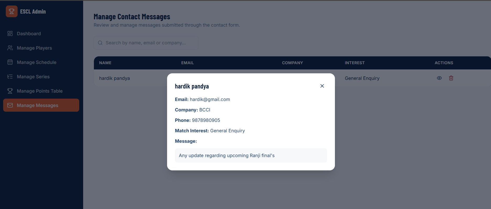

### Admin Dashboard
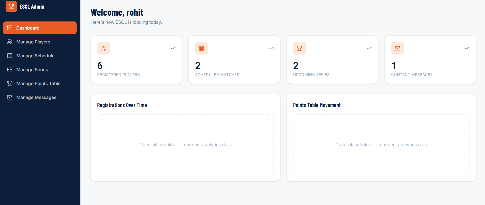